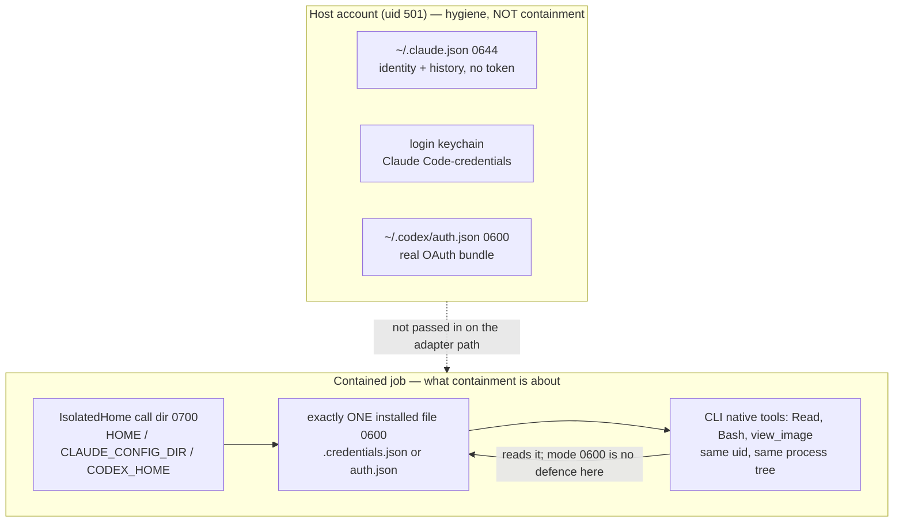

# Credential isolation for contained CLI jobs

This is a feasibility study, not a change. It ships one new test module
(`tests/source/conformance/test_credential_isolation.py`) and no source edits.
It answers the single question verified containment was blocked on:

> Can saved-session authentication be isolated from the CLI's own native tools?

**Yes — the job never has to hold a usable credential at all.** The mechanism
is an egress broker, not a filesystem trick. Verified end to end on both
binaries: the job receives only a **minted** opaque token, the broker swaps in
the real saved-session credential and forwards to the real vendor, the turn
completes, and the real credential appears nowhere under the job home. The
minted token forwarded unchanged is rejected by the vendor with `401` at zero
cost, so it is worthless if a native tool reads it.

Three supporting facts, none previously established: both CLIs send their
credential to an operator-chosen loopback endpoint; both read it exactly once
at startup; and neither validates what it was given. Together they make a
job-scoped credential work **without replacing saved-session auth with API
keys**, which is the outcome this study was required not to assume.

Two findings bound the result. Claude's saved session is reachable two ways and
only one of them survives containment. Codex redirects only through a *custom*
provider — the built-in `openai` provider refuses override — and Codex also
emits provider-independent egress that a base-URL broker does not capture.

Almost all evidence below is local inspection, `--help`/config probes, and real
CLI runs against loopback servers. **Two paid turns were spent**, one per CLI,
on the cheapest model at one turn each, solely to settle whether the vendor
accepts a relayed minted token: `$0.013018` of Anthropic usage as reported by
the CLI, and one small Codex turn (8,481 input / 5 output tokens) billed
against the ChatGPT subscription rather than per token. Everything else,
including the `401` rejection test, cost nothing.

No credential value was read, copied, logged or printed. Credential-bearing
files were identified by mode, size, owner and key name; observed credentials
were recorded only as scheme, length and a truncated SHA-256 fingerprint; the
real credential was held in the broker's memory only and was never written into
a job directory, which is asserted rather than assumed in the results below.

## Two different credential questions, deliberately not conflated

The brief's first question has two answers, and merging them is the mistake
this section exists to prevent.



**Host side.** Where the operator's own credentials live. Real, and worth
fixing, but never passed into a job on the adapter path, so it is not a
containment finding.

**Job side.** What agentkit installs into a job home. One known path agentkit
chooses, not a search problem. This is the surface containment must answer for,
and the native tools reach it because they are the same user in the same
process tree as the process that must read it.

## 1. Where credentials live, exactly

### Host side — verified modes on this machine

| Path | Mode | Owner | Size | Credential-bearing |
| --- | --- | --- | --- | --- |
| `~/.claude.json` | `0644` | `dodo:staff` | 182,492 | **No** — see below |
| `~/.claude` | `0755` | `dodo:staff` | dir | mixed |
| `~/.claude/history.jsonl` | `0644` | `dodo:staff` | 8,753,699 | No, but full prompt history |
| `~/.claude/projects/` | `0755` | `dodo:staff` | dir | transcripts inside are `0600` |
| `~/.claude/settings.json` | `0600` | `dodo:staff` | 764 | could hold `apiKeyHelper` |
| `~/Library/Keychains/login.keychain-db` | `0644` | `dodo:staff` | 324,924 | **Yes**, encrypted |
| `~/.codex` | `0755` | `dodo:staff` | dir | mixed |
| `~/.codex/auth.json` | `0600` | `dodo:staff` | 4,077 | **Yes**, plaintext |
| `~/.codex/config.toml` | `0600` | `dodo:staff` | 468 | No |
| `~/.codex/history.jsonl` | `0600` | `dodo:staff` | 53,774 | No |
| `~/.codex/logs_2.sqlite` | `0644` | `dodo:staff` | 28,327,936 | No, but session logs |
| `~/.codex/session_index.jsonl` | `0644` | `dodo:staff` | 1,057 | No |
| `~/Library/Application Support/Claude` | `0700` | `dodo:staff` | dir | desktop app, unrelated |

Claude Code 2.1.302 is logged in via saved session, and the credential is **in
the macOS login keychain, not in a file**. `~/.claude/.credentials.json` does
not exist on this machine. Keychain generic-password services present:
`Claude Code-credentials`, `Claude Code-credentials-4664aa28`,
`Claude Code-credentials-788217de`, and `Claude Safe Storage`. The
credential's reachability is `$HOME`-relative, which matters in §3.

Codex 0.162.1 is logged in via saved session, and the credential **is a file**.
`~/.codex/auth.json` key names: `auth_mode`, `OPENAI_API_KEY` (null),
`tokens.id_token` (1,812 chars), `tokens.access_token` (1,806),
`tokens.refresh_token` (211), `tokens.account_id` (36), `last_refresh`.

Environment variables each CLI consults, as the drivers already enumerate:

- Claude auth: `ANTHROPIC_API_KEY`, `ANTHROPIC_AUTH_TOKEN`, `ANTHROPIC_BASE_URL`,
  `CLAUDE_CODE_OAUTH_TOKEN`, `CLAUDE_CODE_USE_BEDROCK` / `_VERTEX` / `_FOUNDRY`.
- Claude session linkage: `CLAUDE_CODE_SSE_PORT`, `CLAUDE_CODE_MESSAGING_SOCKET`,
  `CLAUDE_CODE_MESSAGING_TOKEN`, `CLAUDE_CODE_BRIDGE_SESSION_ID`,
  `CLAUDE_CODE_SESSION_ID`, `CLAUDE_CODE_CHILD_SESSION`, `CLAUDE_CODE_ENTRYPOINT`.
  `CLAUDE_CODE_MESSAGING_TOKEN` is a live credential for the parent session's
  IPC socket.
- Codex: `OPENAI_API_KEY`, `CODEX_API_KEY`, `OPENAI_BASE_URL`.

### What world-readable `~/.claude.json` means on its own

Independent of sandboxing, and stated separately because it is a host-hygiene
defect that exists whether or not containment ever ships.

The file is `0644` and 182 KB, so **every local process of every local user can
read it**. It carries **no provider credential**: a scan found zero `sk-ant-`
values and zero JWTs, `oauthAccount` holds only identity and billing metadata
(`accountUuid`, `emailAddress`, `organizationUuid`, `organizationName`,
`organizationRole`, `billingType`, `organizationRateLimitTier`, `displayName`,
`fullName`), and the only two long opaque strings are `userID` and `machineID`,
64 hex characters each. Nothing in it can be replayed to call the provider.

What it does leak is a reconnaissance and privacy set: the operator's email
address, their organization's name, UUID and rate-limit tier, their role, a
stable machine fingerprint, the absolute path of **every project they have
worked in**, per-project `lastSessionId`, cumulative token and cost history,
and `lastSessionFirstPrompt` — the first 200 characters of recent prompts,
which is operator-authored text that can contain anything they typed.

`~/.claude/history.jsonl` is the sharper version of the same defect: `0644` and
8.7 MB of prompt history, world-readable. `~/.claude/projects/` is a `0755`
directory, though the transcripts inside it are correctly `0600`.
`~/.codex/logs_2.sqlite` and `session_index.jsonl` are `0644` session logs.

This is not agentkit's bug and agentkit cannot fix it; it is the vendors' file
modes on this machine. The operator-side remedy is
`chmod 600 ~/.claude.json ~/.claude/history.jsonl` and
`chmod 700 ~/.claude ~/.codex`, and it should be done regardless of this study's
outcome. It is listed here because a reader comparing the two CLIs would
otherwise conclude Claude is the leaky one, when the opposite is true for the
credential itself: **Claude's token is in an encrypted keychain and Codex's is
plaintext at `0600`.**

## 2. When the credential is read — the fact that decides mount-then-drop

Established by observation, not assumption. Both probes pointed the CLI at a
loopback provider, served a multi-turn conversation, and **destroyed the
credential source the instant the first provider request arrived**, then
compared the credential fingerprint on later requests.

| CLI | Credential source removed after request 1 | Later requests | Fingerprint | Session outcome |
| --- | --- | --- | --- | --- |
| Claude 2.1.302 | keychain made unreachable | 3 more arrived | identical on all 4 | `rc=0`, `result: success` |
| Codex 0.162.1 | `auth.json` unlinked | 3 more arrived | identical on all 4 | `rc=0`, `turn.completed` |

**Both CLIs read the credential once at startup and serve the rest of the
session from memory.** Claude's requests 2–4 carried the same 108-byte `Bearer`
fingerprint with the keychain already gone; Codex's requests 2–4 carried the
same `Bearer` fingerprint with `auth.json` already unlinked, and the
`auth_file_present_now` flag recorded `false` for each.

So a two-phase **mount-then-drop is conceivable for both**, and the window is
well-defined rather than a race: the credential read completes before the first
provider request, and the earliest a native tool can run is after the first
provider *response*. agentkit already observes that stream, so "drop after the
first request is seen" is an implementable trigger.

Two limits on this result, both material. The probe covered a short session of
four requests, so **token refresh on expiry was never exercised** — a long job
whose token expires mid-session would need to re-read a source that has been
dropped, and would fail. And the fingerprint proves the token is cached, not
that no other code path re-opens the file later.

## 3. What is mounted into a contained job

The coordinator's correction is right about the adapter path and wrong as a
general statement; both halves matter.

On the **adapter path** (`calls.py`, the route that carries
`ExecutionRequirements` and is the containment surface), the job gets
`env_policy="isolated"` **plus an explicit `HOME` override** pointing at the
`IsolatedHome` call directory, with `XDG_CONFIG_HOME` / `XDG_CACHE_HOME` /
`XDG_DATA_HOME` / `XDG_STATE_HOME` beneath it, `config_dir=home` for Claude
(so `CLAUDE_CONFIG_DIR`) and `config_home=home` for Codex (so `CODEX_HOME`).
The host home, `~/.codex/auth.json` and the login keychain are therefore all
unreachable.

But `env_policy="isolated"` **does not itself hide the host home**: `HOME` is
on `_ISOLATED_PASSTHROUGH` in `_common.py`, alongside `PATH`, `USER`,
`TMPDIR`, the TLS variables and the proxy variables. The protection comes from
the explicit override applied last, not from the policy's name. The source says
so plainly — *"Not a security boundary — a child that runs shell commands can
read the filesystem regardless"*. And the **direct cognition path** defaults to
`effective_env_policy == "inherit"` (or `"profile"` when `config_dir` is set),
so a caller using `ClaudeCliCognition`/`CodexCliCognition` standalone **does**
inherit the real `HOME` and with it every host credential above. That path is
not the containment surface, but the general claim "agentkit never mounts the
user's `$HOME`" is false for it, and a verdict table that assumed otherwise
would be wrong.

Credential-bearing material that reaches a job:

- **One installed file, chosen by agentkit.** `install_credentials(home, mode,
  files)` accepts exactly `.credentials.json` for `claude_code` and `auth.json`
  for `codex`, rejects every other name, rejects path separators, writes with
  `O_WRONLY|O_CREAT|O_EXCL|O_NOFOLLOW` then `chmod 0600`, and refuses to
  overwrite an existing file or a symlink. Teardown is credential-first:
  `_remove()` unlinks every `auth.json` / `.credentials.json` /
  `credentials.json` under the root **before** `rmtree`, so a partially failed
  teardown still removes the secret first.
- **The generated MCP configuration document**, which carries the bridge's live
  bearer token. `serve.py` is explicit: *"the CLI reads the token OUT of this
  file, so anything that can read this file holds the credential."* It is
  created `0600` on the descriptor before any byte is written, with
  `O_NOFOLLOW`, and a symlink at the path is refused.
- **Key-auth environment variables** when the binding uses them:
  `OPENAI_API_KEY`, and `CODEX_API_KEY` mirrored from it for Codex.
- **`--add-dir` roots**, which are caller-supplied and validated only as
  "is a directory" (`driver.py` raises only on non-directories). A caller who
  passes `~` or `~/.codex` reopens the host credential by hand. agentkit's
  lexical narrowing of roots is, as `host-tool-execution.md` already records,
  "not a symlink/filesystem enforcer".

Nothing else credential-bearing reaches a job on the adapter path. The host
keychain in particular is closed by construction on macOS, for the reason §4
gives.

## 4. Every channel a credential could escape through

"Closed" means closed **against the job's own native tools**, which is the only
threat model this study is about. Several channels are closed against other
users and open against the job; that distinction is the point.

| Channel | Status | Evidence |
| --- | --- | --- |
| Host `~/.claude.json`, `~/.codex/auth.json` (adapter path) | **Closed** | `HOME`/`CODEX_HOME`/`CLAUDE_CONFIG_DIR` overridden to the owned home |
| macOS login keychain (adapter path) | **Closed** | keychain is `$HOME`-relative; redirected `HOME` ⇒ "Not logged in · Please run /login" |
| Host credentials on the direct cognition path | **Open** | default `effective_env_policy == "inherit"` keeps the real `HOME` |
| Ambient auth env inherited into the job | **Closed** | `_CLAUDE_AMBIENT_AUTH_ENV` / `_CODEX_AMBIENT_AUTH_ENV` stripped; `isolated` copies only the passthrough list |
| Parent-session IPC token (`CLAUDE_CODE_MESSAGING_TOKEN`) | **Closed** | in `_CLAUDE_SESSION_ENV`, stripped by `profile` and absent under `isolated` |
| The one installed credential file, read by a native tool | **Open — inherent** | new test: a same-user child reads the `0600` file verbatim |
| Key-auth credential in the child environment | **Open — inherent** | the job's own `env`/`Bash` reads its own environment |
| Generated MCP config bearer token | **Open to the job** | `serve.py`: "anything that can read this file holds the credential"; `0600` closes it only to other users |
| argv | **Closed (named keys)** | `_looks_secret` warns on `api_key`/`token`/`secret`/`password`/`credential` keys, exempting `*_env_var` |
| CLI stdout/stderr | **Partly closed** | `_redact_secrets` exists; `test_claude_offline.py` asserts a planted credential never appears in output |
| Process listing / `ps` | **Open — inherent** | same uid |
| Child-process inheritance | **Open — inherent** | descendants inherit env and fds |
| Teardown residue | **Closed, not erasure** | credential-first `_remove()`; new test asserts no credential bytes remain under the home. `host-tool-execution.md`: "File removal is not secure erasure" |
| `--add-dir` roots | **Open — caller's choice** | validated only as directories; no credential-path exclusion |
| Codex provider-independent egress | **Open** | observed `HTTP 451 {"message":"no_biscuit_no_service"}` from `rmcp::transport::worker` with the provider base URL pointed at loopback |

The four rows marked *inherent* are the study's core result restated: they
cannot be closed by file modes, because the native tools and the process that
must read the credential are the same user in the same process tree. They can
only be closed by making what is inside worthless, which is mechanism (c).

## 5. Mechanisms evaluated

### (a) Hide the file

The enforcement primitive exists. `sandbox-exec` is present, and a profile of
`(allow default)` plus `(deny file-read* (literal "<path>"))` denies that one
path to the child **and to a shell grandchild**, while leaving the rest of the
process working — verified, and pinned by a new test. `bwrap` is absent on this
machine; `docker` is present.

It does not solve the problem as a *static* policy, for a structural reason: the
CLI reads the same path its tools would, in the same process, so a deny that
stops `Read` also stops authentication. There is no per-thread or per-call
granularity to exploit.

What does work is the **post-startup drop**, which §2 establishes by
observation: install the credential, start the CLI, and unlink it once the first
provider request is seen. No sandbox is required. Its cost is the refresh case —
a token that expires mid-session cannot be renewed from a source that is gone.

For Claude on macOS there is a bonus already banked: because the keychain is
`$HOME`-relative, the adapter path's `HOME` override **already** makes
keychain-sourced saved-session auth unreachable inside a job. The only route in
is the file agentkit installs, which is exactly the chokepoint mechanism (c)
wants.

### (b) Broker the credential via `apiKeyHelper`

`apiKeyHelper` is real and agentkit already references it, but it **cannot
carry saved-session auth**, and the binary says so itself. `claude --help`,
under `--bare`: *"Anthropic auth is strictly `ANTHROPIC_API_KEY` or
`apiKeyHelper` via `--settings` (OAuth and keychain are never read)."*
`apiKeyHelper` is an API-key path. Routing saved-session auth through it is not
a brokering design, it is the substitution this study was told not to propose.

It also fails on its own terms as an isolation mechanism. The helper is a
*command the CLI runs inside the job*, so it runs as the same user in the same
process tree as the native tools, and its stdout is the key. A native tool can
run the same command and obtain the same key. Brokering changes where the
secret comes from, not who can obtain it — unless the helper authenticates to
an outside broker using something the job does not hold, which is impossible,
because anything the job holds its tools can read. The only way the helper
becomes useful is if what it returns is already worthless outside the job, and
that is mechanism (c) doing the work, not `apiKeyHelper`.

Not verified by execution: no helper was run, because exercising it needs a key.

### (c) Make what is inside worthless — the egress broker

The strongest and cheapest mechanism, and the only one that closes the four
*inherent* channels. agentkit brokers the provider API itself: the job gets a
loopback endpoint and a short-lived, job-scoped token, the genuine credential
stays in the parent process, and a native tool that reads the token gains
nothing usable beyond the job. `install_credentials` is the single chokepoint
where the substitution happens — one function, one allowlisted filename per
mode — which a new test pins by asserting the real secret's bytes appear
nowhere under the job home.

The question was whether either CLI accepts an alternate base URL **with
saved-session auth**, since agentkit's existing offline tests establish only
that it works with API keys (`test_claude_offline.py` passes
`ANTHROPIC_API_KEY` with `--bare`; `test_codex_adapter_offline.py` uses a custom
provider with `env_key="CODEX_API_KEY"`). Both were tested directly.

**Claude Code 2.1.302 — feasible, verified.** With `ANTHROPIC_BASE_URL` set to
`http://127.0.0.1:<port>`, the CLI sent its saved-session OAuth credential to
that endpoint: `POST /v1/messages?beta=true`, `Authorization: Bearer <108
bytes>`, and `anthropic-beta` including `oauth-2025-04-20`. Plain HTTP was
accepted, so a local broker needs no TLS. This held for both routes to a saved
session — the keychain-sourced one, and a file-based
`.credentials.json` carrying `claudeAiOauth.accessToken` **with no keychain
reachable at all**, which completed `rc=0`. That second result is the important
one: it is precisely what `install_credentials` installs, so the brokered token
can be delivered through machinery that already exists.

**Codex 0.162.1 — feasible, verified, but only through a custom provider.**
Overriding the built-in provider is refused outright:

```
Error loading config.toml: model_providers contains reserved built-in provider
IDs: `openai`. Built-in providers cannot be overridden. Rename your custom
provider (for example, `openai-custom`).
```

A **custom** provider with `requires_openai_auth = true` does carry the
saved-session credential to a loopback base URL. Observed against a synthetic
chatgpt-shaped `auth.json` in an owned temporary `CODEX_HOME`:
`GET /v1/models?client_version=0.162.1` three times, then
`POST /v1/responses`, each with `Authorization: Bearer <the access_token from
auth.json>` and a `chatgpt-account-id` header; `turn.completed`, `rc=0`. A
broker must therefore serve `GET /v1/models` as well as the Responses endpoint.

#### The minted token, verified end to end

The remaining question was whether the job can hold a **minted** job-scoped
token while the real credential stays outside — the fact the first pass could
not settle offline. It is now settled in three steps, and the answer is yes for
both CLIs.

**Step 1, free: neither CLI validates the token it is given.** With a loopback
endpoint returning a canned response, Claude 2.1.302 sent a 29-character
`mint_…` token verbatim as `Bearer`, `rc=0` — and did so even with `expiresAt`
set a day in the **past**, without attempting a refresh. A real-shaped
107-character `sk-ant-oat01-…` token behaved identically. So a minted Claude
token may be any opaque string.

Codex is almost as permissive but has one real constraint. The minted
`tokens.access_token` may be any opaque string, **but `tokens.id_token` must be
a well-formed JWT** carrying the `https://api.openai.com/auth` claims. With a
non-JWT `id_token`, Codex issued the request with **no `Authorization` header at
all** (observed: header absent, length 0) — it fails open into sending nothing
rather than refusing, which is a trap worth knowing about. An *expired* JWT
claim was still sent.

**Step 3, free: the minted token is worthless to the vendor.** Forwarding it
unchanged to `api.anthropic.com` returned `HTTP/1.1 401 Unauthorized`, the CLI
reported "Invalid bearer token", and `total_cost_usd` was `0`. The swap is
therefore load-bearing rather than incidental.

**Step 2, paid: the relay works.** One turn per CLI, cheapest model, one turn
maximum. The parent read the real credential into memory only; the job received
only the minted token.

| | Claude 2.1.302 | Codex 0.163.0 |
| --- | --- | --- |
| Minted token presented by the CLI | yes | yes |
| Upstream after swap | `HTTP/1.1 200 OK` | `HTTP/1.1 200 OK` |
| Upstream reached | `api.anthropic.com/v1/messages` | `chatgpt.com/backend-api/codex/responses` |
| Turn outcome | `is_error: false`, `terminal_reason: completed` | `rc=0`, `agent_message: "ok"` |
| **Real credential present in job home** | **no** | **no** |
| Real account id present in job home | n/a | **no** |

Codex needed one extra rewrite: it sends a `chatgpt-account-id` header, so the
broker swaps that for the real account id too. The job was deliberately given a
*different* random account id, and neither the real token nor the real account
id appeared anywhere under the job home. The broker also answers
`GET /v1/models` locally; step 1 showed a failure there is non-fatal, so
relaying it buys nothing.

**The refresh path is the one thing a minted credential cannot do.** Codex
attempted a refresh against `auth.openai.com` and got
`401 token_expired` ("Could not validate your token"), non-fatally, because the
job's refresh token is minted too. This is a design consequence rather than a
defect: **the broker must own refresh**, because a job holding a real refresh
token would defeat the whole arrangement. It also bounds job duration to the
real token's validity unless the broker refreshes on the job's behalf.

Two caveats specific to Codex. First, **a base-URL broker does not confine
Codex's egress.** With the provider pointed at loopback, Codex still reached an
unrelated endpoint and logged
`rmcp::transport::worker ... HTTP 451 {"message":"no_biscuit_no_service"}`.
Provider-egress restriction therefore needs a network boundary outside the CLI
as well as a broker, which is consistent with the existing `U` verdict for
network isolation. Second, `preferred_auth_method` is **ignored** by 0.162.1,
which reported it as an unrecognized configuration setting; the comment in
`codex/driver.py` citing it as the precedence knob is stale on this binary.

### Verdict table

F = feasible with evidence, I = infeasible with the missing capability named,
U = unverified.

| Mechanism | Claude Code 2.1.302 | Codex 0.162.1 |
| --- | --- | --- |
| (a) static read-deny on the credential path | **I** — CLI reads the same path in the same process; no per-call granularity | **I** — same structural reason |
| (a′) post-startup drop | **F** — read once; keychain removed after request 1, 3 later requests identical, `rc=0` | **F** — read once; `auth.json` unlinked after request 1, 3 later requests identical, `rc=0` |
| (a″) host keychain unreachable in a job | **F** — already closed; keychain is `$HOME`-relative and `HOME` is overridden | n/a — credential is a file, closed by `CODEX_HOME` |
| (b) `apiKeyHelper` brokering saved-session auth | **I** — `--bare`: "OAuth and keychain are never read"; key-only path, and the helper runs inside the job | **I** — no counterpart exists |
| (c) egress broker, saved-session auth preserved | **F** — `ANTHROPIC_BASE_URL` to loopback carries the OAuth Bearer; works from an installed `.credentials.json` with no keychain | **F** — custom provider + `requires_openai_auth`; built-in `openai` override refused |
| (c″) minted job-scoped token accepted end to end | **F** — relay verified: minted in, vendor `200 OK`, real credential absent from the job | **F** — relay verified: minted in, vendor `200 OK`, real token and account id absent from the job |
| Minted token is worthless if it leaks | **F** — forwarded unchanged, vendor `401`, `$0` | **F** — same mechanism; `requires_openai_auth` binds to the swapped header |
| (c′) broker also confines provider egress | **U** — no out-of-band endpoint observed, but not proxy-audited | **I** — observed non-provider egress (`HTTP 451`, plus `auth.openai.com`) that base URL does not capture |
| Refresh from inside the job with a minted credential | **I** — by design; the job holds no real refresh token | **I** — observed: minted refresh rejected by `auth.openai.com` (`401 token_expired`), non-fatal |

## What could not be established offline

Each row names the exact command that would settle it, and why it was not run.

The vendor-acceptance question that gated mechanism (c) has been settled and is
no longer on this list; see "The minted token, verified end to end".

| Unresolved | Command that settles it | Cost |
| --- | --- | --- |
| Whether the **broker** can refresh on the job's behalf and hand the job a fresh minted token mid-session | Hold a session open past the real token's `expiresAt` with the broker performing the refresh: `claude ... --max-turns 50` against the broker, real `expiresAt` minutes ahead | Free, but needs a genuinely near-expiry saved session; the minted-side result is already known (the job cannot refresh) |
| Whether a long job survives the real token expiring with no broker refresh | Same setup, broker refresh disabled | Free; needs the same near-expiry window |
| Whether `apiKeyHelper` output is reachable by a native tool in practice | `claude --settings '{"apiKeyHelper":"/path/to/script"}'` with a sentinel-writing script plus a native `Bash` call | **Paid** — needs a working key and a model turn to invoke the tool; verdict (b) does not depend on it |
| Whether Codex's out-of-band egress is suppressible | `codex exec --json` under `HTTPS_PROXY` to a logging proxy with each feature flag toggled; the targets are now known to be `chatgpt.com:443` and `auth.openai.com:443` | Free; not run for time |
| Whether Claude has any out-of-band egress under a broker | Re-run the relay with `HTTPS_PROXY` pointed at a logging proxy and `CLAUDE_CODE_DISABLE_NONESSENTIAL_TRAFFIC` unset | Free; not run for time |
| Whether a native tool can read the **keychain** when it is mounted | `sandbox-exec` profile allowing `mach-lookup` of `com.apple.SecurityServer`, then `security find-generic-password -s "Claude Code-credentials"` inside it | Free; not run because the adapter path already makes the keychain unreachable, so the answer does not change a verdict |
| Whether `docker`-based containment preserves saved-session auth | Run the Claude drop probe inside a container with only the installed `.credentials.json` bind-mounted | Free; out of scope for a filesystem/credential study |
| Complete exclusion of plugin, managed-configuration and memory surfaces | Already recorded as `V` in `host-tool-execution.md`; unchanged by this study | Free but large |

## Recommendation

**Containment should proceed, with mechanism (c) as the credential design and
mechanism (a′) as defence in depth.** The gating question is answered
affirmatively, and answered without substituting API keys for saved sessions.
The verdict is **minting works**: on both tested binaries the job holds only a
minted token, the real saved-session credential never enters the job, and a
turn completes against the real vendor.

The reasoning is that (c) is the only mechanism that closes the four *inherent*
channels in §4. Those channels — the installed file, the job's own environment,
`ps`, and child inheritance — are not closable by permissions, because the
reader and the tools are the same user in the same process tree. Making the
token worthless outside the job is the only move that survives that. The
supporting facts are all now evidenced rather than assumed: both CLIs accept a
loopback endpoint while authenticating from a saved session, both read the
credential once, and `install_credentials` is a single chokepoint with one
allowlisted filename per mode.

Sequencing, cheapest first:

1. Keep the credential outside the job. Substitute a job-scoped token at
   `install_credentials`. No CLI change and no new mechanism is needed, and the
   chokepoint property is already pinned by a test. The minted token may be any
   opaque string for Claude; for Codex the sibling `tokens.id_token` **must** be
   a well-formed JWT with the `https://api.openai.com/auth` claims, or Codex
   silently sends no credential at all.
2. Add the broker behind the existing `ExecutionBackend` seam. For Claude set
   `ANTHROPIC_BASE_URL`; for Codex define a custom provider with
   `requires_openai_auth = true` and serve `GET /v1/models` as well as
   `POST /v1/responses`. Do not attempt to override the built-in `openai`
   provider — it is refused. The broker swaps `Authorization`, and for Codex
   also `chatgpt-account-id`; upstreams are `api.anthropic.com` and
   `chatgpt.com/backend-api/codex`.
3. Give the broker ownership of **refresh**. The job cannot refresh, by design
   and by observation, so the broker must renew against the real credential and
   re-mint. Without this, job duration is bounded by the real token's validity.
4. Drop the installed minted credential after the first provider request is
   observed, as defence in depth. With minting in place this is belt-and-braces
   rather than the protection itself.
5. Treat provider egress as a separate, still-unmet requirement. Codex reaches
   `auth.openai.com` independently of its provider base URL, so a base-URL
   broker is not an egress boundary; network isolation stays `U` and must be
   enforced outside the CLI.

**What the in-job blast radius actually is.** The minted token is a bearer for
the broker and nothing else: forwarded to the vendor unchanged it returns `401`
at zero cost. So a native tool that reads it gains exactly the authority the
broker grants it — which is the broker's design decision, not the provider's.
That is the honest residual: minting moves the blast radius from "the
operator's whole provider account" to "whatever this job was admitted to do",
and the second is only as narrow as the broker's own scoping and lifetime
rules. Scoping the minted token per job, per model and per deadline is
therefore part of the mechanism, not a later hardening step. The job also still
reaches the broker's endpoint, so a tool can spend the job's own quota within
its admitted scope; that is the residual the owner should expect, and it is
bounded rather than open-ended.

**The honest cost if this stops holding.** The result rests on current binary
behaviour, not on a documented contract. Both CLIs accept an unvalidated opaque
token today; a future version that verifies token shape or binds a signature to
the session would break minting without warning, and the version matrix already
moved under this study (Codex auto-updated 0.162.1 → 0.163.0 mid-run). The
fallback is relay with the real credential held in the parent, which still
confines egress but then requires the drop in step 4 to do the isolating, with
refresh as its hard limit.

If instead a future binding makes saved-session auth genuinely non-isolable,
the cost to the consumer is explicit and should be stated rather than
engineered around: contained jobs would require API-key auth, which means an
operator on a subscription plan cannot run contained jobs on their existing
login, must obtain separate key-billed credentials, and pays per-token for work
their subscription already covers. That is a real and possibly unacceptable
price. **This study did not reach that outcome, and nothing here should be read
as recommending it.** Mechanism (c) is feasible on both tested binaries.

## Verification

| Check | Result |
| --- | --- |
| `uv run ruff check agentkit tests` | Passed |
| `uv run pytest tests/source -q` | 2,807 passed, 15 skipped, 2 failed — both pre-existing and unrelated, see below |
| `uv run python .github/scripts/mutants.py --verify` | Passed |
| `make docs-check` | Passed |
| New module `tests/source/conformance/test_credential_isolation.py` | 6 passed |
| Paid relay turns (outside the suite) | Claude `$0.013018`; Codex one subscription turn |

The new tests encode reachability, which is what this study adds;
`tests/source/conformance/test_isolation.py` already covered installation mode,
the filename allowlist and teardown. All five are synchronous, because
`ASYNC230`/`ASYNC240` forbid `open()` and `pathlib`/`os.path` in an async body
and every assertion is a filesystem assertion; the one that needs a coroutine
drives it with `asyncio.run`. The `sandbox-exec` test is skipped off macOS.

No source file was modified. No native-tool policy, spending limit or coverage
threshold was changed. The CLI probes behind §2 and §5 are not in the suite:
they drive real binaries against loopback servers, and the two relay turns
reach the real vendors, so both belong with the existing opt-in real-CLI cases
rather than the default gate. They are reported above rather than claimed as
suite coverage.

The two failures are
`test_host_execution_assessment.py::test_cli_version_changes_are_not_hidden_by_cache`
for both parameters. They are not caused by this study: the suite was green
across the whole of `tests/source` earlier in the same session, and the
failures appeared after `agentkit/models/providers/cli/calls.py` raised
`MINIMUM_TESTED_CLI_VERSION[CLAUDE_CODE]` from `2.1.300` to `2.1.302` while
that conformance test still parametrizes `2.1.300` and still expects a higher
version to be refused. Both the source file and that test belong to another
agent's in-flight work, so they are reported here rather than edited. This
study's own module passes in isolation.

Versions under test drifted during the study and the results are attributed
accordingly: Claude Code 2.1.302 throughout; Codex 0.162.1 for the base-URL
refusal and read-once results, and 0.163.0 for the relay, which auto-updated
mid-study. The minting result held on both Codex versions.
