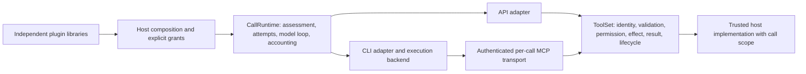

# Policy-controlled host-tool execution

This change starts from revision `a700dbfb1a90f39ca49e9f5ab26f9067ccf476ec`.
It implements a common host policy contract. It does not establish protected
execution for either CLI or introduce a second agent runtime.

## Source-based diagnosis

- `core/runtime/calls.py` owns attempts, retries, structured correction, context,
  token accounting and call events. Injected adapters without an evaluator could
  evade implicit DENY; they now refuse. Explicit requirements already reached
  adapter turns but were absent from runner/delegation and persisted sessions.
- `models/providers/cli/capabilities.py` refuses Claude native-tool absence as
  unverified and Codex absence as unsupported. `codex/driver.py` independently
  rejects DENY. Supplying MCP tools cannot change either native-tool boundary.
- `tools/execution/policy.py` already routed both SDK calls and CLI MCP calls
  through `ToolSet`, including static approval, output validation and deadlines.
  Custom tools lacked uniform JSON Schema input validation; there were no public
  composable permission callbacks or correlated lifecycle observers.
- `integrations/mcp/serve.py` already supplies a per-server bearer fence and
  owned listener/configuration cleanup. It discarded vendor tool-call metadata;
  CLI portable messages subsequently invented a host pairing ID. Whole HTTP
  request bodies also lacked a pre-parser byte bound.
- API request hooks could change the assessed host catalog or schema while those
  requirements still reported supported. CLI binary versions were cached, and
  adapter configuration had no receipt associating assessment with dispatch.
- CLI usage was synthesized from normalized zero defaults when no raw usage
  arrived. Missing measurement now remains incomplete and unpriced; explicit
  numeric zero remains a measurement.

## Ownership and trust

`ToolRegistry` is the explicit callable grant set. `ToolSet` owns validation,
permission composition, approval, effect execution, canonical output validation,
bounded results, cancellation and host lifecycle events. The MCP bridge routes
to it; it has no resource-policy implementation. Native CLI permissions are a
different mechanism and cannot authorize a denied host effect.

External packages supply ordinary tools, guidance and callbacks. AgentKit imports
none of their modules. Skills do not register tools or widen grants. Permission
contributions return `PermissionDecision.ALLOW`, `DENY` or `ASK`; DENY stops
evaluation before prompting or effects, regardless of any ALLOW or ASK from
other contributions. ASK and static `requires_approval` need an explicit host
approval handler. Absence, rejection, invalid decisions, errors and cancellation
all fail closed. Approval never overrides a DENY. If a host approval handler is
configured, CLI transport approval metadata allows delivery to that handler;
the host gate still runs before the effect. Without a handler the existing static
CLI approval metadata remains restrictive.

Observers cannot authorize by returning a value. A requested-observer error
prevents effects. A terminal-observer error is logged with a fixed safe message;
it cannot undo/replay an effect or replace its result. Hosts needing durable
audit must supply durable observer implementations. Observer and permission
awaits are bounded/cancellation-aware. Synchronous Python callbacks, threads
and arbitrary subprocesses remain trusted host code; AgentKit cannot forcibly
stop or sandbox them. All host callbacks can access their own process and its
credentials. This contract does not protect against a malicious/compromised host
callback, backend, provider adapter or installed binary.

## Public contracts and correlation

Import `ToolSet`, `OverflowPolicy`, `ToolResult`, `PermissionDecision`,
`ToolInvocationRequest`, `ToolLifecycleEvent`, `ToolInvocation` and
`current_tool_invocation` from `agentkit.tools`. Import `CallRuntime` from
`agentkit.core.runtime` and call/requirement types from `agentkit.models`.
`CallEvent` is now exported there; `ApiAdapter` is exported from
`agentkit.models.providers.frontiers` for host-owned transport injection.

The permission request contains frozen, schema-validated arguments, the host
scope and invocation identity. Its repr excludes arguments/scope. Do not log
them indiscriminately in host callbacks. Lifecycle observers receive only the
tool name, identity, requested/finished phase and a stable status code. Known
permission/validation refusals provide safe structured codes in `ToolResult`.
Generic tool/permission exceptions do not expose their private messages.
Handlers that intentionally publish a recovery instruction must raise public
`ToolExecutionError(safe_message, code=...)`. The message/code are explicitly
host-reviewed output; exception causes are never copied. Existing deterministic
workflow fixtures use this contract while retaining their effect/accounting
assertions. Consumers relying on arbitrary exception text must migrate those
intentional messages to this contract. Permission/observer callback exceptions
remain fail-closed and cannot use it to bypass policy.

Identities remain distinct:

- Host invocation ID: freshly generated per invocation, retained through policy,
  implementation and observation.
- Provider tool-call ID: actual SDK ID or vendor MCP metadata; unknown/conflicting
  metadata remains `None`. Claude uses `_meta["claudecode/toolUseId"]`, Codex uses
  `_meta["callId"]` on the tested binaries.
- Transport request ID: actual MCP JSON-RPC ID when present.
- Call ID and attempt ID: trusted runtime context, never supplied by model/MCP
  scope metadata. Resume/fork uses the current call ID, not the old session ID.

Provider IDs are correlation, not grant evidence. Task-local bindings reset
after completion/cancellation and do not leak across concurrent calls. CLI
portable tool messages retain all three tool IDs, with provider/host pairing
chosen honestly. The CLI streaming item ID can differ from the provider ID.

The bridge defaults to a fresh bearer token, localhost listener and owned private
configuration for each server. Other jobs' tokens fail before effects. Closed
servers refuse stale calls. Authenticated POST bodies are bounded to 1,048,576
actual bytes before JSON parsing, including chunked/misdeclared lengths; body
completion is bounded to ten seconds. `ToolSet.max_input_bytes` independently
bounds encoded tool arguments before policy/effects. Existing result bounds and
SDK validation remain. These are transport boundaries, not same-user OS or
cross-tenant process isolation; another same-user process that can steal a token
is outside the shipped backend's protection.

## Assessment and execution correspondence

Every requested requirement is evaluated with supported/unsupported/unverified
status, a stable reason code and a safe explanation. Required unverified facts
refuse. Initial local incompatibilities precede credential resolution and
provider attempts, retaining unknown/unpriced cost and incomplete usage.
Hard dollar caps are independently refused in all four modes.

Adapter configuration receipts reject a configuration changed between assessment
and adapter entry. API transport configuration is also captured before awaiting
the credential resolver. The runtime forwards its receipt on every turn. CLI
versions are re-inspected instead of cached; untested versions cannot satisfy
required protocol capabilities. `MINIMUM_TESTED_CLI_VERSION` is a FLOOR per mode
— Claude **2.1.302**, Codex **0.162.1** — replacing the previous exact-match
pin. A binary at or above its floor keeps `HOST_TOOLS`, `SCHEMA` and `USAGE`;
anything below refuses.

The shape is an owner decision with a liability attached, and the liability is
stated rather than buried. The exact pin failed in the direction that is easy to
miss: measured, Claude 2.1.302 against a 2.1.300 pin downgraded all three
requirements to `cli_protocol_version_unverified` while the protocol itself was
intact, so the refusal reported staleness and read as evidence of a missing
mechanism. A floor removes that. What it buys it with is that `>=` CREDITS
versions nobody has run — and the three shipped bugs recorded in
`tests/source/unit/models/providers/cli/test_cli_version_matrix.py` (a removed
flag, a flag moved to the parent command, a retired stream vocabulary) were all
FORWARD breaks that a floor admits. The trade taken is that a vendor's wire
protocol is additive in practice, so credit is extended upward on that
expectation.

The extrapolation is visible in the assessment, not only in a comment. A binary
strictly above the floor reports those three requirements as SUPPORTED with the
code `cli_protocol_version_above_tested_floor` and an explanation naming both
the floor and the installed version, so an operator can tell an inferred credit
from a measured one. A binary exactly at the floor keeps `adapter_supported`,
because it was measured. Downward there is no extrapolation at all.

Three details decide whether a floor is honest, and each has its own test.
Comparison is on parsed numeric components, never on text: `"2.1.9" < "2.1.302"`
is false as text and true as software, and Claude's patch numbers are already
three digits, so a string comparison would credit a binary from before any
characterization and refuse the installed one. `packaging` is not imported —
this package declares no runtime dependencies — so the comparison is a
zero-padded tuple compare, which also makes `3.0` and `3.0.0` equal rather than
ordering them by component count. And a version string that cannot be read as a
release number never passes: an unreadable `--version` is exactly what a vendor
produces when it changes that output, which is also when the protocol is most
likely to have moved. The parser tolerates the decorated forms the binaries
print, `2.1.302 (Claude Code)` and `codex-cli 0.162.1`, and refuses an ambiguous
line rather than guessing which number is the release.

The floor values are what was actually run, and a floor is the LOWEST credited
version rather than the newest — setting it higher refuses binaries that were
characterized. Claude 2.1.302 is the lowest Claude binary characterized against
a real process here; 2.1.300 has the older record below but is not installed and
was not re-run, so it is NOT the floor. Codex 0.162.1 is the lowest codex
version characterized in the session that set these values. The table is a
`MappingProxyType`, so nothing in the process can lower it and collect a
SUPPORTED verdict it did not earn.

The case for the floor stopped being hypothetical during that session: the
installed `codex` upgraded itself from 0.162.1 to 0.163.0 mid-run. Under the
previous exact pin every codex strict profile would have begun refusing on the
spot, with a reason naming a missing mechanism, on a binary whose real-process
acceptance test still passed. Under the floor it is credited and labelled
`cli_protocol_version_above_tested_floor`, and `test_codex_adapter_offline.py`
independently passed against 0.163.0 — granted host operation dispatched,
denied host call refused — so in this instance the extrapolation happens to be
backed by a measurement. It will not always be, which is the whole content of
the trade.

Raising a floor is an evidence claim. `tests/source/integration/execution/test_claude_execution_profile.py`
is what earns a Claude floor, and it refuses to agree with the table in either
direction: at or above must assess SUPPORTED, below must refuse.

Version inspection now uses `isinstance` rather than `type(...) is` against the
shipped subprocess backend. The identity test handed every SUBCLASS a weaker
refusal set than the base class — no version inspection, therefore no
`cli_protocol_version_unverified`, and no `cli_binary_unverified` either —
although a subclass still reaches `super().start()` and still spawns the real
binary. Both real-process suites in this repository subclass it in order to
route the approved invocation at a local scripted provider, so the version gate
was inert in precisely the tests that exist to characterize a version. With the
gate live, those twelve Claude profiles refused on 2.1.302 until the version was
characterized. A backend that does not spawn a local binary implements the
`ExecutionBackend` port instead of inheriting this one and is unaffected.

Version matches and receipt hashes never promote an
isolation boundary. Receipts identify local adapter configuration, not binary
integrity, a remote worker lease or an attestation. They are not portable
authorization tokens. All strict CLI profiles remain refused.

The CLI backend invocation carries mode, call/attempt IDs, requirements and
effective native policy alongside its frozen launch options. The ordinary
backend uses the same evaluator and rejects incompatible metadata before process
creation. An unidentified provider cannot carry protected requirements. A host
backend declaration cannot promote containment, or turn Codex's unsupported
native absence into a merely unverified mechanism.

`SessionHandle` now retains execution requirements and native-tool policy.
Resume/fork inherits them; additional requirements union with them and explicit
roots/destinations intersect. This lexical narrowing is not a symlink/filesystem
enforcer. Runner verification/delegation forwards the same requirements.

The runtime still owns attempts/retries/corrections and settlement. A runtime
attempt counts an adapter invocation, not each internal CLI provider request.
Initial known incompatibility yields zero attempts. Changes detected after an
attempt starts retain their confirmed `not_started` provider-dispatch detail;
the started runtime attempt is not erased. CLI process/worker uncertainty and
cleanup behavior retain their existing typed failures. This change does not
claim control of vendor billing or CLI-internal retries.

## Capability matrix

S = supported within stated scope; V = unverified, U = unsupported. Required V/U
refuses. Entries describe shipped adapters with the ordinary subprocess backend,
no unrestricted request hooks, and characterized CLI protocol versions.

| Requirement | OpenAI API | Anthropic API | Claude Code | Codex |
| --- | --- | --- | --- | --- |
| Granted host-tool protocol and shared policy | S | S | S | S |
| Native tools unavailable | S | S | V | U |
| Complete MCP allowlist boundary | V | V | V | V |
| Structured answer protocol and canonical validation | S | S | S | S |
| Usage reporting with incomplete measurement distinguished | S | S | S | S |
| Observed spending threshold between turns | S | S | U | U |
| Exact hard dollar cap | U | U | U | U |
| Filesystem/network/process/credential/configuration isolation | U | U | U | U |
| Complete descendant/provider cancellation requirement | V | V | U | U |

The three Claude Code protocol rows — granted host-tool protocol, structured
answer protocol, usage reporting — read S only on a binary at or above
`MINIMUM_TESTED_CLI_VERSION`. Below it they are V and the mode refuses; strictly
above it they are S with `cli_protocol_version_above_tested_floor`, which says
the credit was inferred from a floor rather than measured on that binary. Measured on 2.1.302 under a DENY ceiling, the surviving refusals
are `native_tools_unavailable` (V) and `mcp_allowlist` (V); the protocol rows no
longer contribute to that refusal, which is the whole point of re-measuring
them.

The API wire declares granted functions only, not provider-side MCP servers or
native tools. The broader `MCP_ALLOWLIST` requirement also covers host MCP
implementations; arbitrary host callbacks remain trusted and unverified under
that broader boundary. Unrestricted request hooks make native absence and
catalog/schema support unverified. The tested CLI host protocol can execute
under deliberately selected non-strict policies; that does not satisfy DENY.
This work never translates DENY into another policy.

## Real CLI evidence and remaining blockers

The real-process tests use empty temporary homes, synthetic credentials and
local scripted provider endpoints. They are independent of paid/authenticated
provider tests. Both providers run granted host effects, refuse denied and
unattended host calls, retain actual IDs and return typed answers.

Claude Code 2.1.300 passes twelve adapter profiles: fresh/resume/fork/correction
with API-key, staged-home API-key and fake OAuth-shaped saved-session credentials.
The local server verifies expected authentication selection without logging the
header. Planted native Read/Bash, user/project hooks and discovered MCP commands
cause no effects. Skill/project-instruction canaries do not reach the provider.

### Claude Code 2.1.302, characterized

2.1.302 passes fifteen adapter profiles — fresh/resume/fork/correction/**cancellation**
across the same three credential profiles — plus a schema-presence pair and a
credential-separation case. The authentication profiles are load-bearing rather
than decorative: the adapter drops `--bare` whenever a credential is staged into
the home or a bearer token is used, so `staged_api_key` and `saved_session`
exercise the profile that must hold WITHOUT the one flag that disables discovery
wholesale. Measured directly: `--bare` is not load-bearing for any surface below.
`--setting-sources ""`, `--tools ""`, `--strict-mcp-config` with an empty
`--mcp-config`, and `--disable-slash-commands` produce an identical empty wire
catalogue with and without it.

Every plant is proved CAPABLE before its exclusion is allowed to mean anything.
A control run of the same binary over the same planted tree, in the same
`HOME`/`CLAUDE_CONFIG_DIR` layout the adapter produces, with the restriction
flags removed, must fire every sentinel and put every canary on the wire. Eight
sentinel files and five instruction canaries, from nine distinct surfaces:

| planted surface | live without restrictions | executed under the adapter profile |
| --- | --- | --- |
| project `.claude/settings.json` hook | yes | no |
| project `.claude/settings.local.json` hook | yes | no |
| project `.mcp.json` undeclared MCP server | yes | no |
| user `settings.json` hook (config dir) | yes | no |
| plugin auto-loaded from the skills directory (hook + MCP + skill) | yes | no |
| plugin installed by `claude plugin marketplace add` / `install` (hook + MCP + skill) | yes | no |
| project `CLAUDE.md` | reaches wire | no |
| user `CLAUDE.md` memory (config dir) | reaches wire | no |
| project `.claude/skills/*/SKILL.md` | reaches wire | no |

Provider-side planted `tool_use` for `Read`, `MemoryRead`, `Bash`, `Write`,
`Skill` and an undeclared `mcp__planted-project__*` name are refused by the
binary itself with `No such tool available`, and their sentinel files — a `Bash`
`touch` and a `Write` outside the job directory — do not appear. The granted
host operation executes in the same assistant message, so the run cannot pass by
never getting far enough to attempt the violations.

Three surfaces were planted and could NOT be made to fire even with every
restriction lifted, so they are recorded here and asserted on nowhere: the
top-level `mcpServers` table in `~/.claude.json`, `AGENTS.md`, and a `CLAUDE.md`
inside an `--add-dir` directory. An unproven plant is not evidence; asserting on
one manufactures a pass. Enterprise managed settings at an OS path were NOT
planted — writing one needs root, and no flag agentkit passes overrides it.

Credential separation is measured as a twin rather than an absence. The local
provider refuses to answer unless it receives the exact staged bearer token, so
a green authentication check is positive evidence the CLI child held the
credential; the same secret, the API key and the refresh token are then absent
from `/usr/bin/env` run inside a granted host tool, and `ANTHROPIC_API_KEY` /
`ANTHROPIC_AUTH_TOKEN` are absent from that subprocess entirely. No credential
value appears in any `argv` the adapter builds. This is environment and argv
separation only; the staged home is a same-user directory and a same-user
process that can read it is outside this boundary.

### `StructuredOutput` is a protocol helper, not an authority

Decided explicitly, with the measurement behind it. Under the strictest profile
agentkit ships, the wire catalogue is `{mcp__agentkit__allowed, StructuredOutput}`
when a schema is requested and `{mcp__agentkit__allowed}` when none is — so the
helper is a consequence of asking for a schema, not a resident. It carries no
path, command or destination; its arguments ARE the answer and still pass the
host's canonical validation and correction loop; and it produces no host
invocation, hence no permission decision and no lifecycle event (the only
lifecycle name observed in a schema run is the granted tool). It therefore
expands no authority and needs no grant.

It is nevertheless a NATIVE tool, injected by the binary and never granted by
the host, present on the wire under that same strictest profile. That is a
measured counterexample to "no native tool is available", and it is now the
stated reason `native_tools_unavailable` stays V for Claude rather than a
footnote. The two facts are not in tension: the helper is safe AND native-tool
absence is unproven.

Native-tool absence stays V for a second, independent reason. `--tools ""` and
`--setting-sources ""` are CLI configuration, not an OS boundary: the process
retains full user authority, agentkit cannot verify the binary honours a flag
beyond the cases measured here, and the three plants that would not fire show
the surface enumeration is demonstrably incomplete. Absence cannot be
established by enumeration.

Per the owner's direction, absence is no longer the target for CLI modes.
**Containment** — no authority beyond the admitted job — is, and it is a
distinct capability: SDK modes may satisfy absence while CLI modes satisfy
containment. The evidence above is containment evidence for the CONFIGURATION
boundary specifically, and it is not yet sufficient for it. CONFIGURATION stays
U pending: enterprise managed settings at an OS path that no agentkit flag
overrides, a mechanism that makes the exclusion set enumerable rather than
sampled, and environment-variable configuration surfaces. The remaining
boundaries — filesystem roots including symlinks, egress filtering, process and
peer separation, complete descendant reaping — are unchanged.

Tests still do not prove vendor acceptance of saved credentials or real token
refresh. No paid provider turn was run for this characterization: the provider
is a local socket and every credential is a synthetic string.

Codex 0.162.1 clean/planted twins use the real adapter. `view_image` executes and
sends an outside synthetic image to the local provider under current feature
restrictions and read-only sandboxing. Existing probes independently show write
denial alongside allowed outside reads. This proves why DENY remains U. A complete
immutable native-tools-off mechanism, including resumed sessions, is required
upstream. Approval settings and read-only sandboxes cannot replace it.

Both CLIs need independently verified control-plane/tool-executor credential
separation before contained native execution can be supported. The backend must
then establish file roots including symlinks, egress/private-endpoint filtering,
configuration discovery exclusion, process/peer separation and complete
descendant reaping. A same-user temporary HOME or container sharing native tools
and its auth file is insufficient. The subprocess backend establishes a private
environment and process group only. Detached descendants can escape that group;
cleanup cannot claim complete termination. File removal is not secure erasure.
Existing credential rotation callbacks and staged credential cleanup remain.

Official mechanism references (not attestations of these binaries):
[Claude CLI reference](https://code.claude.com/docs/en/cli-reference),
[Codex configuration reference](https://developers.openai.com/codex/config-reference/).
Their current content cannot certify older binaries. Actual local tests determine
the claims above.

## Standalone integration and migration

See [the example](../../tests/examples/plugin_execution/README.md) and
[the examples index](../../tests/examples/README.md) for exact setup/run commands,
the independent plugin contributions and test classifications. Only the binding
changes across modes; no application-specific dispatcher or MCP service exists.

Consumers should:

1. Build an explicitly granted `ToolRegistry` and attach resource permissions and
   observers through `ToolSet`. Scope must come from host context, not model args.
2. Treat ASK as refused unless an explicit bounded host approval handler exists.
   Use observer return values for nothing; use permissions for policy decisions.
3. Pass the phase's `ExecutionRequirements` through the existing runtime/runner.
   Assess before selecting a connection, then handle typed local incompatibility.
4. Persist complete session restrictions. Older sessions reconstructed from IDs
   require the host to re-supply and reassess their policy ceiling.
5. Distinguish runtime attempts, CLI internal requests, usage completeness,
   unpriced cost, observed thresholds and unsupported hard caps.

The consuming application retains plugin composition, tenancy, binding selection,
workflow and ledger ownership. No changes to its model-call runtime are required.
No package version bump or published release is included.

## Verification

The final implementation passes the repository gate. Skipped or unrun checks
are not enforcement evidence; protected CLI acceptance remains unmet as described
above. No native-tool policy, spending limit, test assertion or coverage
threshold was relaxed to make a mode execute.

| Check | Final result |
| --- | --- |
| `AGENTKIT_SKIP_REAL_CLI=1 AGENTKIT_LIVE=0 PYTEST_ADDOPTS=-rs make check` | Passed |
| Coverage run, Python 3.13.14 | 2,669 passed, 55 skipped, 0 failed |
| Python 3.12 matrix | 2,669 passed, 55 skipped, 0 failed |
| Python 3.13 matrix | 2,669 passed, 55 skipped, 0 failed |
| Coverage | 91%; existing 89% threshold unchanged |
| Ruff lint and strict mypy | Passed; 149 source files typed |
| Formatting of new/formatted modules, tests and examples | 49 files passed |
| Documented imports | 14 checked, 0 unresolved |
| Focused host-policy/assessment/bridge regressions | 53 passed, 0 skipped, 0 failed |
| Separate real-process execution suite | 24 passed, 0 skipped, 0 failed |
| Standalone plugin example and existing example entry points | 23 passed (19 plugin + 4 entry points), 0 skipped, 0 failed |
| Mutation target baseline, isolated copy | 1,378 passed, 0 failed |
| Full mutation catalogue, isolated source and dedicated virtual environment | 242/242 killed, 0 survivors/unrunnable |
| Mutation restoration | SHA-256 hashes matched for all 149 source files; isolated copy removed |
| Local wheel and source distribution | Built successfully as `arc-agentkit` 0.1.0; no publication |

The main gate's 55 skips are 16 offline CLI cases run separately above, 24 opt-in
CLI parser/version-matrix cases, 14 paid/provider-authenticated cases and one
optional msgspec case. Real provider/subscription acceptance and vendor token
refresh were not run. Installed versions independently inspected with empty
temporary homes were Claude Code 2.1.300 and Codex 0.162.1. The separate CLI probes
use only synthetic credentials and local scripted providers.

### Re-verification against Claude Code 2.1.302

| Check | Result |
| --- | --- |
| `claude --version` / `codex --version`, empty temporary home | 2.1.302 (Claude Code); codex-cli 0.162.1, which self-upgraded to 0.163.0 during the session |
| `test_claude_execution_profile.py` (new) | 54 passed, 0 skipped, 0 failed |
| Full suite, real CLIs enabled, three consecutive randomized runs | 2,837 passed, 16 skipped, 0 failed |
| `uv run ruff check agentkit tests` | Passed |
| `uv run mypy --strict agentkit` | Passed; 149 source files |
| `uv run python .github/scripts/mutants.py --verify` | All anchors resolve; nothing left mutated |
| Paid provider turns | none; $0 spent |

Moving to a floor invalidated one existing conformance test by design rather
than by regression. `test_cli_version_changes_are_not_hidden_by_cache`
represented "an untested version" with `999.0.0`, which a floor credits by
construction, and asserted `2.1.300` compatible, which a 2.1.302 floor refuses.
Its real invariant — a version change is not hidden by a cache — survives in
`planted.binary_version`, so the test was re-aimed rather than deleted: the
sentinel for "not characterized" is now an OLD version (`0.0.1`), because under
a floor every future-looking sentinel is a credited one. Three further
conformance tests were added alongside it so that each direction of the floor is
independently pinned: at/above/below the floor per mode, below-the-floor values
whose TEXT sorts above it (`2.1.9`, `2.1.99`), and six unreadable version
strings that must refuse.

Observed red before the code changed, in order: the new file's import of the
version table (symbol absent); then, once the gate was made
`isinstance`-based, all twelve existing real-adapter Claude profiles refused with
`cli_protocol_version_unverified` on 2.1.302 — the finding that the gate had
been inert for subclassed backends; then the new characterization's fifteen
profiles refused the same way with zero processes started, which is the failure
the pin entry had to earn. The entry was added as a hypothesis and the
characterization confirmed it; had it failed, the entry comes back out.

Two fixture bugs were found and are worth recording because each produced a
green-looking wrong answer. Annotating a host tool's `ctx` parameter pulled it
into the generated JSON Schema, so every granted call came back `Tool arguments
do not match the granted schema` while the run still answered through the schema
helper — an "effect never happened" that looks like a passing test unless the
effect itself is asserted. And a `content_block_start` carrying the final `text`
with no following `text_delta` is accepted by a lenient parser and ignored by
the real client: 2.1.302 accumulated an empty assistant message, kept looping
and returned `result: ""`, which surfaces as `transport produced no answer`.

Not run, and therefore not claimed: no paid model turn was made against either
CLI or either API for this work, so nothing here attests vendor acceptance of
the saved-session credential shape, vendor token refresh, or the behaviour of a
real model choosing to call a granted tool on 2.1.302. The opt-in command for
that step is
`set -a && source .env.eval && set +a && AGENTKIT_LIVE=1 uv run pytest tests/source/live -q -p no:randomly`,
on `claude-haiku-4-5` / `gpt-4o-mini`; it is a handful of short turns, on the
order of a few cents, and it remains unfunded and unrun.

Mutation entries for the new gate are warranted and were NOT added, because
`.github/scripts/mutants.py` is out of scope for this change. Four mutants would
each be killed by a named new test:

- comparing version strings instead of parsed release numbers →
  `test_the_floor_compares_release_numbers_and_never_version_text`
- treating an unparseable version as passing the floor →
  `test_a_version_string_that_cannot_be_read_never_passes_the_floor`
- turning `not _at_least(...)` into a strict `>` (off-by-one at the floor) →
  `test_a_binary_below_the_tested_floor_refuses_the_protocol_profile`
- restoring `type(...) is SubprocessExecutionBackend` →
  `test_a_backend_subclass_cannot_dodge_the_version_gate`

Focused regressions were observed red before behavior changes: 14 host-policy
cases, 14 real-adapter CLI identity/context cases, four adapter receipt cases,
four asynchronous configuration-mutation cases, two missing-usage cases (their
two measured-zero twins already passed), the protected backend-port case, and
three implicit-DENY cases (Codex already refused). All four example-layout tests
failed on the former flat layout before the moves. Tests also caught private
exception leakage before adding the explicit safe-error contract. Fixture errors
were corrected separately and are not enforcement evidence.

Intermediate broad gates reported 20 failed/2,648 passed/55 skipped, then three
failed/2,666 passed/55 skipped. They exposed recovery messages being hidden and
a forwarding test relying on an unassessed adapter under DENY. Curated business
and framework recovery messages now use explicit safe failures; their effect,
approval, idempotency and accounting assertions remain. The forwarding fixture
now identifies its no-process scripted transport explicitly, and a separate
four-mode guard test requires zero dispatch from an unassessed adapter. An
intermediate mutation baseline reported two gateway failures and correctly
stopped without claiming mutation success; the final baseline and catalogue pass.

The mutation runner used `--allow-dirty` only inside a disposable copy with its
own virtual environment. No source mutation ran in the working repository or
overlapped tests against its source. Five new mutants cover host DENY, unattended
approval, input validation, stale receipts and transport body bounds. An existing
backend-guarantee mutant was re-anchored to the stronger refusal condition.
