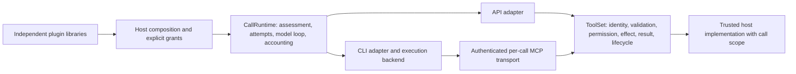

# Policy-controlled host-tool execution

This change starts from revision `a700dbfb1a90f39ca49e9f5ab26f9067ccf476ec`.
It implements a common host policy contract. It does not establish protected
execution for either CLI or introduce a second agent runtime.

## Source-based diagnosis

- `core/runtime/calls.py` owns attempts, retries, structured correction, context,
  token accounting and call events. Injected adapters without an evaluator could
  evade implicit DENY; they now refuse. Explicit requirements already reached
  adapter turns but were absent from runner/delegation and persisted sessions.
- `models/providers/cli/capabilities.py` refuses Claude native-tool absence as
  unverified and Codex absence as unsupported. `codex/driver.py` independently
  rejects DENY. Supplying MCP tools cannot change either native-tool boundary.
- `tools/execution/policy.py` already routed both SDK calls and CLI MCP calls
  through `ToolSet`, including static approval, output validation and deadlines.
  Custom tools lacked uniform JSON Schema input validation; there were no public
  composable permission callbacks or correlated lifecycle observers.
- `integrations/mcp/serve.py` already supplies a per-server bearer fence and
  owned listener/configuration cleanup. It discarded vendor tool-call metadata;
  CLI portable messages subsequently invented a host pairing ID. Whole HTTP
  request bodies also lacked a pre-parser byte bound.
- API request hooks could change the assessed host catalog or schema while those
  requirements still reported supported. CLI binary versions were cached, and
  adapter configuration had no receipt associating assessment with dispatch.
- CLI usage was synthesized from normalized zero defaults when no raw usage
  arrived. Missing measurement now remains incomplete and unpriced; explicit
  numeric zero remains a measurement.

## Ownership and trust

`ToolRegistry` is the explicit callable grant set. `ToolSet` owns validation,
permission composition, approval, effect execution, canonical output validation,
bounded results, cancellation and host lifecycle events. The MCP bridge routes
to it; it has no resource-policy implementation. Native CLI permissions are a
different mechanism and cannot authorize a denied host effect.

External packages supply ordinary tools, guidance and callbacks. AgentKit imports
none of their modules. Skills do not register tools or widen grants. Permission
contributions return `PermissionDecision.ALLOW`, `DENY` or `ASK`; DENY stops
evaluation before prompting or effects, regardless of any ALLOW or ASK from
other contributions. ASK and static `requires_approval` need an explicit host
approval handler. Absence, rejection, invalid decisions, errors and cancellation
all fail closed. Approval never overrides a DENY. If a host approval handler is
configured, CLI transport approval metadata allows delivery to that handler;
the host gate still runs before the effect. Without a handler the existing static
CLI approval metadata remains restrictive.

Observers cannot authorize by returning a value. A requested-observer error
prevents effects. A terminal-observer error is logged with a fixed safe message;
it cannot undo/replay an effect or replace its result. Hosts needing durable
audit must supply durable observer implementations. Observer and permission
awaits are bounded/cancellation-aware. Synchronous Python callbacks, threads
and arbitrary subprocesses remain trusted host code; AgentKit cannot forcibly
stop or sandbox them. All host callbacks can access their own process and its
credentials. This contract does not protect against a malicious/compromised host
callback, backend, provider adapter or installed binary.

## Public contracts and correlation

Import `ToolSet`, `OverflowPolicy`, `ToolResult`, `PermissionDecision`,
`ToolInvocationRequest`, `ToolLifecycleEvent`, `ToolInvocation` and
`current_tool_invocation` from `agentkit.tools`. Import `CallRuntime` from
`agentkit.core.runtime` and call/requirement types from `agentkit.models`.
`CallEvent` is now exported there; `ApiAdapter` is exported from
`agentkit.models.providers.frontiers` for host-owned transport injection.

The permission request contains frozen, schema-validated arguments, the host
scope and invocation identity. Its repr excludes arguments/scope. Do not log
them indiscriminately in host callbacks. Lifecycle observers receive only the
tool name, identity, requested/finished phase and a stable status code. Known
permission/validation refusals provide safe structured codes in `ToolResult`.
Generic tool/permission exceptions do not expose their private messages.

Identities remain distinct:

- Host invocation ID: freshly generated per invocation, retained through policy,
  implementation and observation.
- Provider tool-call ID: actual SDK ID or vendor MCP metadata; unknown/conflicting
  metadata remains `None`. Claude uses `_meta["claudecode/toolUseId"]`, Codex uses
  `_meta["callId"]` on the tested binaries.
- Transport request ID: actual MCP JSON-RPC ID when present.
- Call ID and attempt ID: trusted runtime context, never supplied by model/MCP
  scope metadata. Resume/fork uses the current call ID, not the old session ID.

Provider IDs are correlation, not grant evidence. Task-local bindings reset
after completion/cancellation and do not leak across concurrent calls. CLI
portable tool messages retain all three tool IDs, with provider/host pairing
chosen honestly. The CLI streaming item ID can differ from the provider ID.

The bridge defaults to a fresh bearer token, localhost listener and owned private
configuration for each server. Other jobs' tokens fail before effects. Closed
servers refuse stale calls. Authenticated POST bodies are bounded to 1,048,576
actual bytes before JSON parsing, including chunked/misdeclared lengths; body
completion is bounded to ten seconds. `ToolSet.max_input_bytes` independently
bounds encoded tool arguments before policy/effects. Existing result bounds and
SDK validation remain. These are transport boundaries, not same-user OS or
cross-tenant process isolation; another same-user process that can steal a token
is outside the shipped backend's protection.

## Assessment and execution correspondence

Every requested requirement is evaluated with supported/unsupported/unverified
status, a stable reason code and a safe explanation. Required unverified facts
refuse. Initial local incompatibilities precede credential resolution and
provider attempts, retaining unknown/unpriced cost and incomplete usage.
Hard dollar caps are independently refused in all four modes.

Adapter configuration receipts reject a configuration changed between assessment
and adapter entry. API transport configuration is also captured before awaiting
the credential resolver. The runtime forwards its receipt on every turn. CLI
versions are re-inspected instead of cached; untested versions cannot satisfy
required protocol capabilities. The characterized protocol versions are Claude
2.1.300 and Codex 0.162.1. Version matches and receipt hashes never promote an
isolation boundary. Receipts identify local adapter configuration, not binary
integrity, a remote worker lease or an attestation. They are not portable
authorization tokens. All strict CLI profiles remain refused.

The CLI backend invocation carries mode, call/attempt IDs, requirements and
effective native policy alongside its frozen launch options. The ordinary
backend uses the same evaluator and rejects incompatible metadata before process
creation. An unidentified provider cannot carry protected requirements. A host
backend declaration cannot promote containment, or turn Codex's unsupported
native absence into a merely unverified mechanism.

`SessionHandle` now retains execution requirements and native-tool policy.
Resume/fork inherits them; additional requirements union with them and explicit
roots/destinations intersect. This lexical narrowing is not a symlink/filesystem
enforcer. Runner verification/delegation forwards the same requirements.

The runtime still owns attempts/retries/corrections and settlement. A runtime
attempt counts an adapter invocation, not each internal CLI provider request.
Initial known incompatibility yields zero attempts. Changes detected after an
attempt starts retain their confirmed `not_started` provider-dispatch detail;
the started runtime attempt is not erased. CLI process/worker uncertainty and
cleanup behavior retain their existing typed failures. This change does not
claim control of vendor billing or CLI-internal retries.

## Capability matrix

S = supported within stated scope; V = unverified, U = unsupported. Required V/U
refuses. Entries describe shipped adapters with the ordinary subprocess backend,
no unrestricted request hooks, and characterized CLI protocol versions.

| Requirement | OpenAI API | Anthropic API | Claude Code | Codex |
| --- | --- | --- | --- | --- |
| Granted host-tool protocol and shared policy | S | S | S | S |
| Native tools unavailable | S | S | V | U |
| Complete MCP allowlist boundary | V | V | V | V |
| Structured answer protocol and canonical validation | S | S | S | S |
| Usage reporting with incomplete measurement distinguished | S | S | S | S |
| Observed spending threshold between turns | S | S | U | U |
| Exact hard dollar cap | U | U | U | U |
| Filesystem/network/process/credential/configuration isolation | U | U | U | U |
| Complete descendant/provider cancellation requirement | V | V | U | U |

The API wire declares granted functions only, not provider-side MCP servers or
native tools. The broader `MCP_ALLOWLIST` requirement also covers host MCP
implementations; arbitrary host callbacks remain trusted and unverified under
that broader boundary. Unrestricted request hooks make native absence and
catalog/schema support unverified. The tested CLI host protocol can execute
under deliberately selected non-strict policies; that does not satisfy DENY.
This work never translates DENY into another policy.

## Real CLI evidence and remaining blockers

The real-process tests use empty temporary homes, synthetic credentials and
local scripted provider endpoints. They are independent of paid/authenticated
provider tests. Both providers run granted host effects, refuse denied and
unattended host calls, retain actual IDs and return typed answers.

Claude Code 2.1.300 passes twelve adapter profiles: fresh/resume/fork/correction
with API-key, staged-home API-key and fake OAuth-shaped saved-session credentials.
The local server verifies expected authentication selection without logging the
header. Planted native Read/Bash, user/project hooks and discovered MCP commands
cause no effects. Skill/project-instruction canaries do not reach the provider.
The wire still exposes the native `StructuredOutput` helper. Tests do not prove
every plugin, managed configuration or memory surface excluded, vendor acceptance
of saved credentials, or real refresh. Native-tool absence thus remains V.

Codex 0.162.1 clean/planted twins use the real adapter. `view_image` executes and
sends an outside synthetic image to the local provider under current feature
restrictions and read-only sandboxing. Existing probes independently show write
denial alongside allowed outside reads. This proves why DENY remains U. A complete
immutable native-tools-off mechanism, including resumed sessions, is required
upstream. Approval settings and read-only sandboxes cannot replace it.

Both CLIs need independently verified control-plane/tool-executor credential
separation before contained native execution can be supported. The backend must
then establish file roots including symlinks, egress/private-endpoint filtering,
configuration discovery exclusion, process/peer separation and complete
descendant reaping. A same-user temporary HOME or container sharing native tools
and its auth file is insufficient. The subprocess backend establishes a private
environment and process group only. Detached descendants can escape that group;
cleanup cannot claim complete termination. File removal is not secure erasure.
Existing credential rotation callbacks and staged credential cleanup remain.

Official mechanism references (not attestations of these binaries):
[Claude CLI reference](https://code.claude.com/docs/en/cli-reference),
[Codex configuration reference](https://developers.openai.com/codex/config-reference/).
Their current content cannot certify older binaries. Actual local tests determine
the claims above.

## Standalone integration and migration

See [the example](../../tests/examples/plugin_execution/README.md) and
[the examples index](../../tests/examples/README.md) for exact setup/run commands,
the independent plugin contributions and test classifications. Only the binding
changes across modes; no application-specific dispatcher or MCP service exists.

Consumers should:

1. Build an explicitly granted `ToolRegistry` and attach resource permissions and
   observers through `ToolSet`. Scope must come from host context, not model args.
2. Treat ASK as refused unless an explicit bounded host approval handler exists.
   Use observer return values for nothing; use permissions for policy decisions.
3. Pass the phase's `ExecutionRequirements` through the existing runtime/runner.
   Assess before selecting a connection, then handle typed local incompatibility.
4. Persist complete session restrictions. Older sessions reconstructed from IDs
   require the host to re-supply and reassess their policy ceiling.
5. Distinguish runtime attempts, CLI internal requests, usage completeness,
   unpriced cost, observed thresholds and unsupported hard caps.

The consuming application retains plugin composition, tenancy, binding selection,
workflow and ledger ownership. No changes to its model-call runtime are required.
No release artifact is created by these working-tree changes.

## Verification

Exact final tallies are recorded after the repository gate, separate example
tests, actual CLI probes and isolated mutation catalogue complete. Skipped or
unrun checks are not enforcement evidence.
